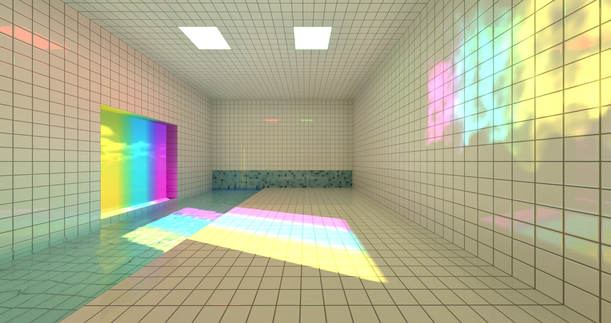

import Bilibili from "../../components/mdx/Bilibili.astro";
import LinkRow from "../../components/mdx/LinkRow.astro";

纯 Web 全局光、自发光、玻璃、交互水、焦散、真实大气与 HDR。

演示在 B 站。分项说明见[文章](/blog/voxpool/)。

<Bilibili bvid="BV12mnw66E6T" />

<LinkRow items={[
  { label: "看演示", href: "https://www.bilibili.com/video/BV12mnw66E6T/" },
  { label: "打开体验", href: "https://www.bilibili.com/toy/voxpool/index.html" },
  { label: "爱发电", href: "https://afdian.com/a/shaofun" },
]} />

项目不开源。支持开发见[爱发电](https://afdian.com/a/shaofun)。
