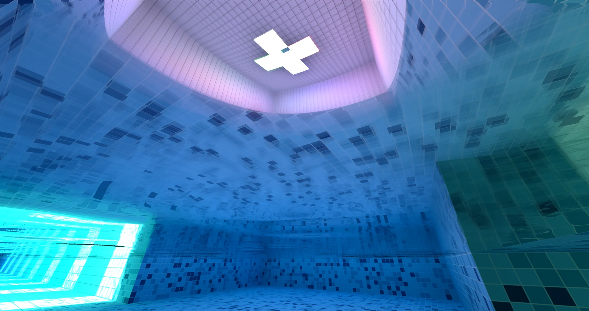
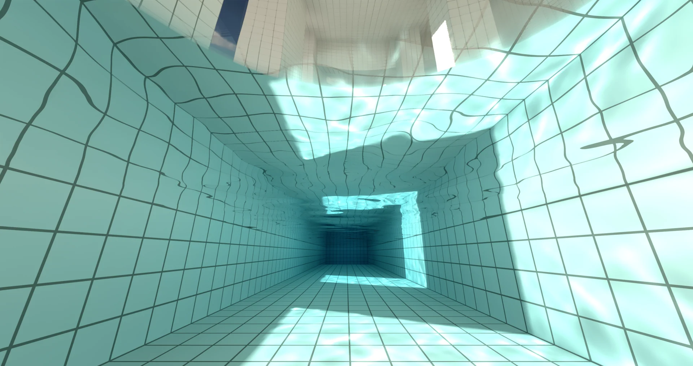
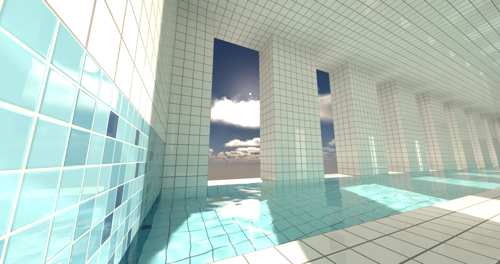

import Bilibili from "../../../components/mdx/Bilibili.astro";
import LinkRow from "../../../components/mdx/LinkRow.astro";
import MetricGrid from "../../../components/mdx/MetricGrid.astro";

体素池核是一套浏览器里的实时光感引擎。纯 Web，基于 WebGPU，打开即用。桌面和手机都能跑，手机可以满 60 帧。

<MetricGrid items={[
  { value: "60 帧", label: "手机可满帧运行" },
  { value: "WebGPU", label: "浏览器直接打开" },
  { value: "HDR", label: "高动态范围输出" },
  { value: "光追", label: "全局光照与焦散" },
]} />

演示在 B 站。第一条是桌面，第二条是手机。

<Bilibili bvid="BV12mnw66E6T" />

<LinkRow items={[
  { label: "看演示", href: "https://www.bilibili.com/video/BV12mnw66E6T/" },
  { label: "打开体验", href: "https://www.bilibili.com/toy/voxpool/index.html" },
  { label: "爱发电", href: "https://afdian.com/a/shaofun" },
]} />

## 光照

全局光追。天光、日光和灯光在体素表面之间传递，室内跟着窗口和灯一起亮。

自发光。白、红、绿、蓝荧光石直接照亮周围。

玻璃（青、品红、黄）。透射光带颜色。封面是玻璃、自发光和水面焦散叠在同一帧里。

## 水

交互水。可以走进去，也可以潜下去。水面有反射和折射。

焦散。反射和折射把光打到墙面、地面和天花板，并跟着波纹动。

## 天空

真实大气。太阳、月亮、星辰按天体位置运行，有云，时间可以拨。

HDR。高光保留，明暗随场景适应。桌面和支持 HDR 的手机走同一套画面。

地图可以改：瓷砖、水、灯、玻璃。步行、游泳、飞行都能进。仍在研发，需要支持 WebGPU 的浏览器。项目不开源。

继续做下去的支持，在[爱发电](https://afdian.com/a/shaofun)。
