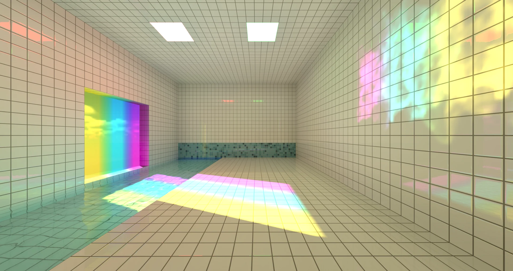
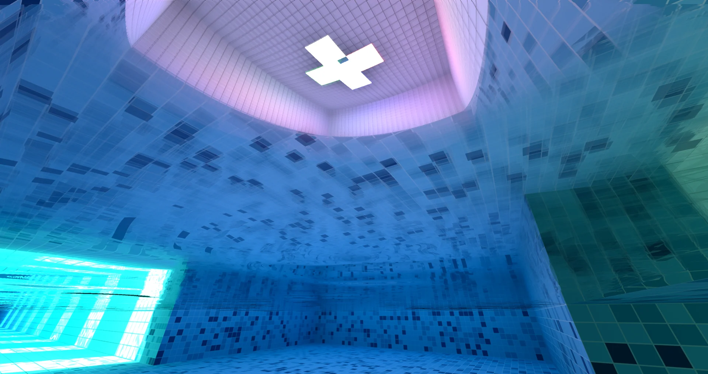
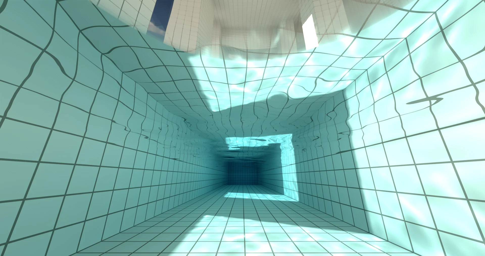
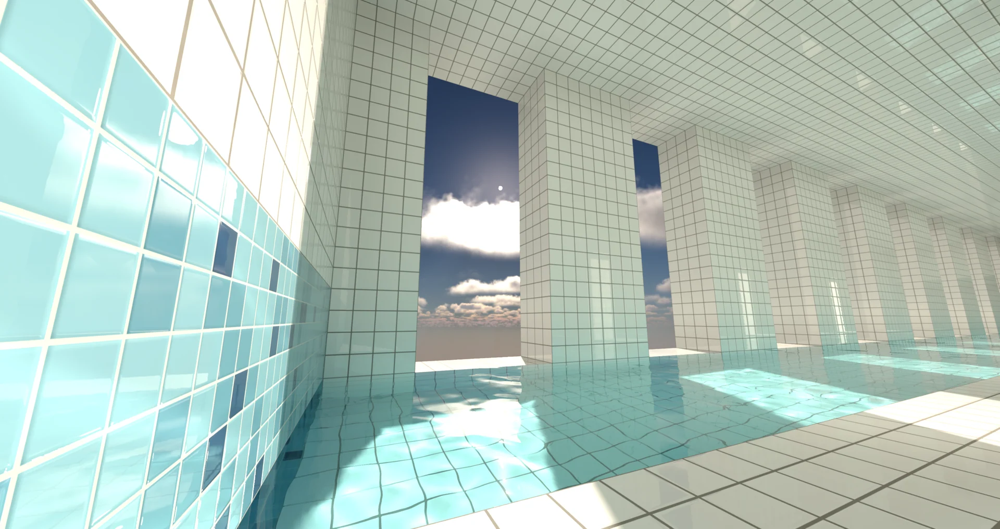

import { Image } from "astro:assets";
import Bilibili from "../../../components/mdx/Bilibili.astro";
import LinkRow from "../../../components/mdx/LinkRow.astro";
import Community from "../../../components/voxpool/Community.astro";
import ember from "../../../assets/voxpool/maps/ember.webp";
import aeropolis from "../../../assets/voxpool/maps/aeropolis.webp";
import reverie from "../../../assets/voxpool/maps/reverie.webp";

体素池核 VOXPOOL 是浏览器里的体素漫游与造景工具。你可以潜进泳池，穿过房间，换一块玻璃或放一块灯，看光怎样落到周围的墙面。

[VOXPOOL 项目页](/voxpool/)收录了各张地图的画面、玩法和体验入口。需要支持 WebGPU 的浏览器，键鼠、触屏和手柄都能操作。

## 六张新地图，从水院走到云端

11 月 6 日，VOXPOOL 更新到 0.13.0。泳池、后室与康奈尔盒之外，新增六处空间，预置地图共九张。点设置旁的地图按钮，会出现一屏封面，选中一张就能进去。

封面是这次重做的**潮汐浴殿**。白瓷拱顶罩住蓝色马赛克浴池，宽天窗把光引进水中。池边步道保持在同一层，可以从入口走到后方较安静的浴池。另一张[天光水院](/voxpool/#map-oculus)把屋顶收成阶梯状天窗，适合抬头看云，再低头找水里的光。

### 红色楼梯与云边水道

**赤陶庭院**有对向楼梯、高处连桥和十字形水池。可以沿楼梯爬高，再回头看红白墙面的倒影。跳跃现在是按住蓄力、松开起跳，轻点则小跳。高处的路线会用到这个动作。

<Image src={ember} alt="红白楼梯与连桥围着庭院，池水映出红色墙面" widths={[480, 720, 1040, 1280]} sizes="(min-width: 50rem) 45rem, 92vw" format="webp" />

**天空水城**把水渠抬到露天的白色门洞之间。走到开口边缘，能看到水面、连续的门框和远处的云。这张地图也有需要蓄力跳跃的高处路线。

<Image src={aeropolis} alt="蓝色水渠穿过巨大白色门框，四周敞向天空和云层" widths={[480, 720, 1040, 1280]} sizes="(min-width: 50rem) 45rem, 92vw" format="webp" />

### 彩色玻璃与透明水庭

**梦境回廊**用青色和品红玻璃围出开放顶棚。太阳位置改变时，地面和水里的色带也跟着移动。沿水边绕一圈，能从透过玻璃的光看到水中的倒影。

<Image src={reverie} alt="傍晚的青色与品红玻璃回廊倒映在浅池中" widths={[480, 720, 1040, 1280]} sizes="(min-width: 50rem) 45rem, 92vw" format="webp" />

[棱镜水庭](/voxpool/#map-prism)把透明玻璃放在镜面台座上，周围是浅水与绿色小岛。换个角度看，玻璃的透射和台座上的反射会叠到一起。六张新地图的[完整图集在项目页](/voxpool/#maps)。

## 光照

天光、日光和灯光在体素表面之间传递。拆掉一面墙，或者把灯换个位置，房间里的明暗会跟着改变。

白、红、绿、蓝荧光石能照亮周围。青、品红和黄色玻璃让透过的光带上颜色。

## 水

可以走进去，也可以潜下去。水面有反射和折射，光穿过波纹后，在墙面、池底和天花板上形成移动的焦散。

按住跳跃控制可以向上游，靠近池岸时松开，可以跃出水面。

## 天空与显示

太阳、月亮和星空随时间与地点变化。可以调整场景时间，观察光从不同方向照进房间。

HDR 与 Display P3 会分别检测设备支持情况。实际能显示的亮度和色域取决于浏览器与屏幕；可用时启用相应输出，其余设备使用 SDR。

## 改房间与存地图

切到自由模式后，可以飞行、拆除和放置方块。键鼠用左键拆、右键放；触屏点按放置、长按拆除。瓷砖、水、灯和玻璃都能改。

地图和当前进度可以存成压缩的 `.vpool` 文件，下次导入继续。在 B 站 Toy 登录后，还可以手动保存和读取云存档。

渲染过程、纹理预算与可复现的焦散对照，见[技术白皮书](/voxpool/whitepaper/)。项目持续开发，源码未开放。

<Community />

## 看演示与继续体验

<Bilibili bvid="BV1fusX6VEAi" title="烧风的 VOXPOOL 实机演示" />

<LinkRow items={[
  { label: "VOXPOOL 项目页", href: "https://shao.fun/voxpool/" },
  { label: "B 站 Toy", href: "https://www.bilibili.com/toy/voxpool/index.html" },
  { label: "爱发电", href: "https://afdian.com/a/shaofun" },
]} />

[2026 年 10 月的早期光照演示](https://www.bilibili.com/video/BV12mnw66E6T/)仍可回看。
